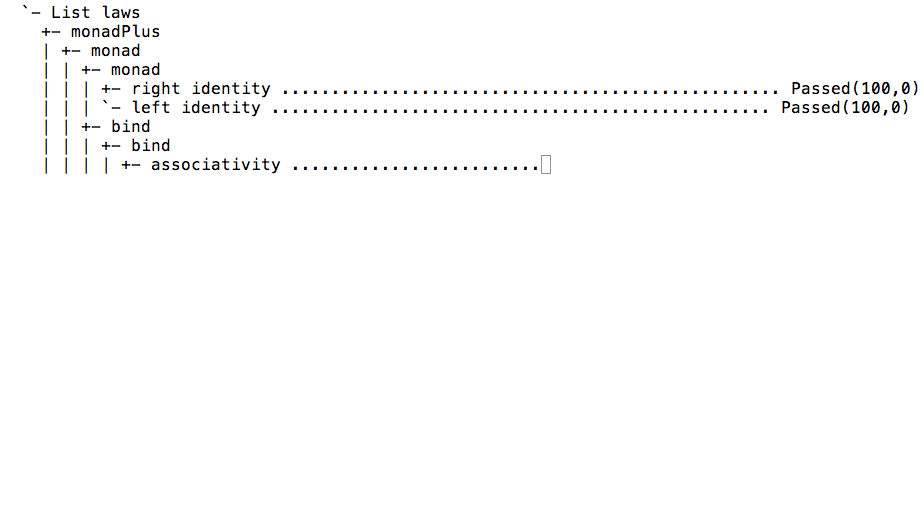
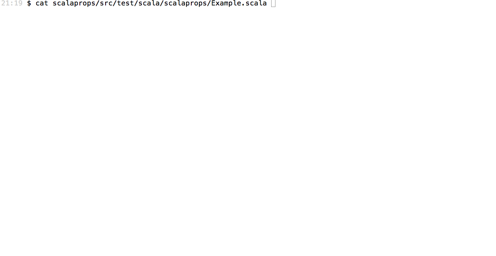

# scalaprops

[](https://www.scala-js.org)
[](https://javadoc.io/doc/com.github.scalaprops/scalaprops-all_3)

Property-based testing library for Scala.

### Features
- Real `scala.FunctionN` generators using [`Cogen`](gen/src/main/scala/scalaprops/Cogen.scala) (known as [CoArbitrary](https://hackage.haskell.org/package/QuickCheck-2.8.1/docs/Test-QuickCheck-Arbitrary.html#t:CoArbitrary) in QuickCheck). Scalaprops can generate non-constant functions.
- Flexible parameter settings for each test ([ScalaCheck does not have this feature](https://github.com/typelevel/scalacheck/issues/120)).
- Timeouts are handled as soon as possible.
- Flexible law checking, similar to [Discipline](https://github.com/typelevel/discipline).
  - Discipline uses only `String` values for test IDs, but scalaprops supports other types as well.
- Scalaz integration.
  - Laws for Scalaz type classes.
  - [`Gen`](gen/src/main/scala/scalaprops/Gen.scala) and [`Cogen`](gen/src/main/scala/scalaprops/Cogen.scala) instances for Scalaz data types.
- An immutable random number generator.
  - scalaprops does not use `scala.util.Random` because it is mutable.
  - The default implementation is [Mersenne Twister](http://www.math.sci.hiroshima-u.ac.jp/~m-mat/MT/emt.html) (JVM and Scala Native) or [Tiny Mersenne Twister](http://www.math.sci.hiroshima-u.ac.jp/~m-mat/MT/TINYMT/) (Scala.js).
- [Scala.js](https://www.scala-js.org/) support.
- [Scala Native](http://scala-native.org) support. See <https://github.com/scalaprops/scalaprops-native-example>.
- [Deterministic testing](#deterministic-testing).

### Setup

The [sbt plugin](https://github.com/scalaprops/sbt-scalaprops) is recommended because it provides several convenient features.


<details><summary>Setup without the sbt plugin</summary>

```scala
testFrameworks += new TestFramework("scalaprops.ScalapropsFramework")

Test / parallelExecution := false // currently, does not support parallel execution

libraryDependencies += "com.github.scalaprops" %% "scalaprops" % "0.12.0" % "test"
```

```scala
libraryDependencies += "com.github.scalaprops" %% "scalaprops-scalaz" % "0.12.0" % "test"
```

</details>




### Deterministic testing

When a test fails, Scalaprops reports the seed it started with and provides the `--seed=<value>` option to rerun the test with the same seed.



### Examples

See the [scalaprops-examples](https://github.com/scalaprops/scalaprops-examples) project.
